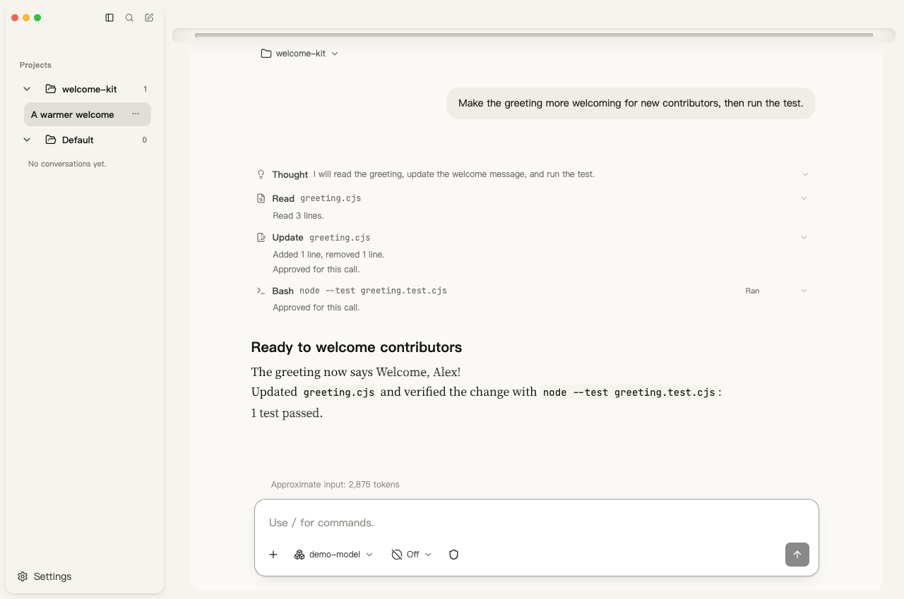
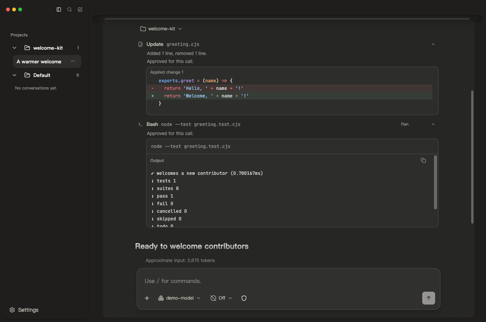
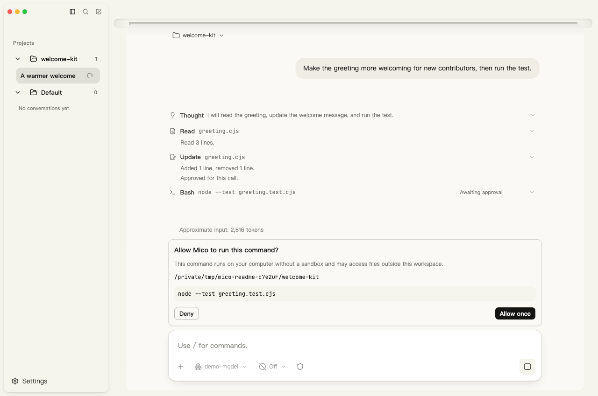

# Mico

**A desktop AI workspace for conversations, code, and visible agent work.**

Chat with your models, work inside a project, and follow the steps behind an answer. Mico brings streaming responses, file changes, terminal output, and tool approvals into one desktop interface.

Mico is an early-stage, open-source project built with Electron, React, and TypeScript. Connect a local model or your own provider to get started.

<picture>
  <source media="(prefers-color-scheme: dark)" srcset="docs/production/workspace-dark.png">
  <source media="(prefers-color-scheme: light)" srcset="docs/production/workspace-light.png">
  
</picture>

*One workspace, from the request to the result. [Light preview](docs/production/workspace-light.png) · [Dark preview](docs/production/workspace-dark.png)*

## What you can do

- **Keep conversations with their projects.** Switch workspaces, revisit saved conversations, and search your history.
- **Follow a response as it arrives.** Read streaming Markdown and highlighted code, expand reasoning when the provider supplies it, or stop an answer and continue the conversation.
- **Inspect the work behind the answer.** Browse file reads, edits, search results, and shell output in expandable tool details.
- **Choose your models.** Connect Ollama, LM Studio, or endpoints using OpenAI Responses, Chat Completions, and Anthropic Messages. Adjust reasoning effort where supported.
- **Bring project context and skills.** Use project instructions and invoke discovered skills with `$`. Use `/` for conversation commands, including manual context compaction.
- **Continue longer conversations.** Mico can summarize completed history before accepting a new turn above its application input budget.
- **Reuse saved preferences.** Ask Mico to remember, find, or forget user and project knowledge. Memory writes require approval, and new turns can reuse saved preferences.
- **Make the workspace comfortable.** Choose light, dark, or system appearance, theme presets, and code highlighting themes. Resize the sidebar and navigate with keyboard shortcuts.

## See what changed

Tool calls stay alongside the conversation. Open a file diff to review an edit, or inspect the command and its output without leaving the app. During streaming, expanding a read or a reasoning step preserves that view as more steps arrive.



## Review actions before they run

When the selected permission mode requires approval, Mico shows the requested operation and lets you allow or deny it. The conversation keeps the tool's outcome available for inspection.

<details>
<summary>Preview a command approval</summary>



</details>

*Screenshots use a sample project and a scripted local demo provider. The file edit and test command run through the application's real tools; the demo is not a model-quality benchmark.*

## Get started

### Run from source

Install **Node.js 22.12 or later** and **pnpm**, then run these commands from the repository root:

```sh
pnpm install
pnpm dev
```

### Connect a model

1. Open **Settings → Providers**.
2. Configure a provider's base URL and API key if required. Use **Add custom provider** for your own endpoint.
3. Fetch or add models, then enable the provider and the models you want to use.
4. Return to the conversation and choose a model in the composer.
5. Choose a workspace folder and start a conversation.

Ollama uses its native API. For LM Studio, start its local server and add a Chat Completions-compatible provider. See the [provider guide](packages/ai-providers/README.md#supported-providers) for supported protocols and base URL behavior.

Model availability, tool calling, and reasoning support depend on the provider and model. Mico does not include a hosted model service. Conversations are stored locally; requests and their included context are sent to the provider you configure.

## Development

| Command | Purpose |
| --- | --- |
| `pnpm dev` | Run the Electron app with the development server |
| `pnpm lint` | Apply lint fixes and formatting |
| `pnpm typecheck` | Check the application and workspace packages |
| `pnpm test:lint` | Check lint without modifying files |
| `pnpm test` | Run application and workspace unit tests |
| `pnpm build` | Type-check and build the application |
| `pnpm test:e2e --project=electron` | Run local Electron scenarios after building |

For packaging, use `pnpm build:mac`, `pnpm build:win`, or `pnpm build:linux` on the appropriate platform. See [CI and release procedures](docs/ci.md) for packaging and signing details.

The Electron host owns storage, approvals, and event delivery. [`@mico/coding-agent`](packages/coding-agent/README.md) orchestrates coding sessions, tools, skills, and context compaction. It runs the model loop from [`@mico/agent-core`](packages/agent-core/README.md) against [`@mico/ai-providers`](packages/ai-providers/README.md). The renderer uses shared components from [`@mico/ui`](packages/ui/README.md).

- [Design and ownership](docs/design.md)
- [Development and verification](docs/agent-guide.md)
- [Electron testing and isolation](tests/e2e/README.md)
- [Contribution instructions for AI agents](AGENTS.md) and [optional context loading](docs/agent-context-loading.md)

## Inspiration

Mico draws on [Pi](https://github.com/earendil-works/pi), [OpenAI Codex](https://github.com/openai/codex), and [dsh](https://github.com/deepseek-ai/deepseek-harness) for agent-runtime ideas; [shadcn/ui](https://ui.shadcn.com/), [Lody](https://github.com/LodyAI/Lody), and the community's [Open Claude UI analysis](https://openclaudeui.com/docs) inform the interface work.

## License

[GNU Affero General Public License v3.0](LICENSE).
